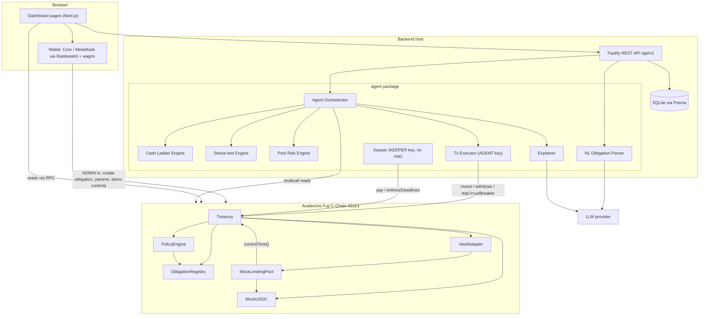

# RunwayMind — AI CFO for DAOs

*The Treasury That Never Runs Out of Cash. The AI That Never Exceeds Its Authority.*

RunwayMind manages a DAO's stablecoin treasury around its **future obligations** — payroll, grants, invoices. It invests
only capital that is genuinely idle within a safety horizon, pulls funds back before every payment deadline, and pays
obligations on-chain on the due date. An AI agent recommends and executes treasury moves, but every limit it works
within — reserve ratio, deadlines, exposure, whitelist, no outbound transfers, circuit breaker — is enforced by smart
contracts on Avalanche, so even a hacked agent cannot move funds out. Built for Team1 Vietnam UniHack 2026 (Avalanche,
track: AI Agents & Security).

**Network:** Avalanche Fuji C-Chain (chain ID 43113).

## Problem

DAOs keep most of their treasury in stablecoins and have fixed recurring costs. Today they choose between two bad
options: **keep funds idle** (safe, earns nothing, runway shrinks) or **deposit into DeFi lending pools** (earns yield,
but a pool can be paused, exploited or 100 % utilized exactly when payroll is due — Euler Finance and SVB, March 2023).
Existing yield bots optimize *balance × APY* and do not know that payroll is due next week.

## Solution — three pillars

| Pillar | What it does | Enforced by |
|---|---|---|
| **Obligation-aware Cash Ladder** | Projects future outflows; only capital not needed within the safety horizon *H* (14 days) is invested; funds return before each obligation's withdrawal deadline | Off-chain engine computes, on-chain `PolicyEngine` enforces (R1, R2) |
| **Bounded AI agent** | Recommends (Approve mode) or executes (Auto mode) invest / withdraw / circuit-breaker actions, with LLM explanations grounded in engine facts, Pool Risk Score and natural-language obligation entry. The LLM never produces numbers used in transactions | On-chain `Treasury` + `PolicyEngine` (R1–R6) |
| **Automated on-chain payments** | Obligations are paid on the due date to the registered recipient through `pay()`; keeper functions are public, so payroll does not depend on the team's server | `Treasury.pay()`, `Treasury.enforceDeadlines()` |

This is banking Asset-Liability Management (match asset maturity to liability maturity) applied to DeFi.

## Web app

| Page | What you can do |
|---|---|
| Dashboard | Runway, upcoming obligations, withdrawal timeline and pending agent recommendations to approve |
| Treasury Overview | Idle vs invested balances, adapters, circuit breaker |
| Obligation Management | Create (form or plain language), edit, cancel and filter payroll / grants / invoices |
| Cash Ladder | Required reserve, investable capital, liquidity projection and withdrawal schedule |
| Yield Vault | Invest into / withdraw from whitelisted adapters within R1–R6 |
| Pool Risk Dashboard | Safety score (0–100) per lending pool and its history |
| AI Agent Activity | Agent decisions, executed actions, keeper runs; switch APPROVE / AUTO mode |
| Transaction History | Every on-chain transaction with status, events and Snowtrace link |
| Settings & Policy Configuration | Safety horizon, emergency buffer, exposure cap, adapter whitelist |

Reading is open to anyone; changes require connecting the ADMIN wallet and signing in (Sign-In with Ethereum).

## Architecture



Monorepo (pnpm workspaces): `contracts/` (Solidity 0.8.24, Foundry, OpenZeppelin 5.1), `packages/shared` (types, zod
schemas, ABIs, deployments), `agent/` (pure engines, orchestrator, executor, keeper, LLM), `backend/` (Fastify 4,
Prisma 5), `frontend/` (Next.js 14, wagmi 2, RainbowKit 2, TanStack Query 5, Recharts).

## Security model

The AGENT key can only move funds **between the Treasury and whitelisted adapters** and trip the circuit breaker.
There is no transfer, sweep, approve, `receive` or `fallback` on the Treasury; the only outbound token transfer is
`pay(obligationId)` to a recipient that only ADMIN can register.

| Rule | Guarantee | Enforced in |
|---|---|---|
| R1 Reserve Ratio | Idle balance after an investment ≥ obligations due within *H* + emergency buffer | `PolicyEngine.checkInvest` |
| R2 Withdrawal Deadline | Funds for an obligation are back in the Treasury *H* before its due date; anyone can call `enforceDeadlines()` | `PolicyEngine.liquidityShortfall`, `Treasury.enforceDeadlines` |
| R3 Exposure Limit | Balance in one adapter ≤ `maxExposureBps` × total assets | `PolicyEngine.checkInvest` |
| R4 Whitelist | Only `ACTIVE` adapters receive funds (`WITHDRAW_ONLY` can only be drained) | `PolicyEngine.checkInvest`, `adapterStatus` |
| R5 No External Transfer | Structural: no function can send Treasury funds anywhere except `pay()` | `Treasury` (absence of functions) |
| R6 Circuit Breaker | AGENT or ADMIN can stop all new investment; only ADMIN can reset; withdrawals and payments keep working | `Treasury.invest` guard |

Hacked-agent demo: `pnpm demo:attack` (Fuji) or `pnpm demo:attack --network local` (Anvil) sends five attacks with the AGENT key (transferFrom, direct adapter withdraw, raw
`transfer` selector, fake obligation, invest beyond reserve). All five revert on-chain, the last with
`ReserveViolation`.

## Deployed contracts — Avalanche Fuji (43113)

Addresses link to Snowtrace. Machine-readable copy: [deployment/fuji.json](deployment/fuji.json).

**Demo treasury (MockUSDC, demo mode)** — deploy block `60935515`

| Contract | Address |
|---|---|
| Treasury | [`0xea19CD2eE794e29c977f85d867BF730Cf65eab92`](https://testnet.snowtrace.io/address/0xea19CD2eE794e29c977f85d867BF730Cf65eab92) |
| ObligationRegistry | [`0x4B0e94ECCf64175385374F091c1A424c9543FA36`](https://testnet.snowtrace.io/address/0x4B0e94ECCf64175385374F091c1A424c9543FA36) |
| PolicyEngine | [`0xa862F86092Aa6625A771f964cDAaa50a36BbFA53`](https://testnet.snowtrace.io/address/0xa862F86092Aa6625A771f964cDAaa50a36BbFA53) |
| VaultAdapter | [`0x31762954AdDD4FbAB318B9Ac375083434BA01d66`](https://testnet.snowtrace.io/address/0x31762954AdDD4FbAB318B9Ac375083434BA01d66) |
| MockLendingPool | [`0x7300607b351A7D0295b81A798264b35B54d91fDa`](https://testnet.snowtrace.io/address/0x7300607b351A7D0295b81A798264b35B54d91fDa) |
| MockUSDC (6 decimals) | [`0x561c9B3C8532C577a4b65D0b1E881FB485e58B50`](https://testnet.snowtrace.io/address/0x561c9B3C8532C577a4b65D0b1E881FB485e58B50) |

| Role | Address |
|---|---|
| ADMIN (deployer) | `0xaC9309a1C6C150D98111AfffF851D07AD650CB5E` |
| AGENT | `0x901999461cB4ecF9d971458A6aaf4bFbEbbB0051` |
| KEEPER (no role) | `0xe052cDe7C1c7060fCE44e862FD6E60307c3649B1` |

The `AaveV3Adapter` proves the same Treasury works with a real protocol on an Avalanche **mainnet fork**
(`forge test --match-path "test/fork/*" --fork-url $env:AVALANCHE_MAINNET_RPC_URL`).

## Run locally (Windows PowerShell)

Requirements: Node ≥ 22.13, pnpm 11, Foundry (`forge`, `anvil`, `cast`).

```powershell
pnpm install
Copy-Item .env.example .env           # fill in keys/RPC (see comments in .env.example); never commit .env
pnpm build                            # forge build + all workspace packages
pnpm test                             # forge test + all workspace tests
```

Local chain (Anvil):

```powershell
anvil --chain-id 31337                                                            # terminal 1
forge script scripts/Deploy.s.sol --rpc-url http://127.0.0.1:8545 --broadcast    # terminal 2 (Anvil key 0)
forge script scripts/SeedDemo.s.sol --rpc-url http://127.0.0.1:8545 --broadcast
pnpm sync-abi
pnpm --filter @runwaymind/backend db:deploy
pnpm --filter @runwaymind/backend db:seed
pnpm dev                                                                          # API :4000, UI http://localhost:3000
```

Fuji: set the Fuji RPC and the DEPLOYER / AGENT / KEEPER keys in `.env`, then `pnpm dev`. To deploy, verify and seed a
fresh demo treasury on Fuji (new contract addresses; the current `deployment/fuji.json` is backed up first):
`pnpm demo:reset -- --network fuji --verify`. Hacked-agent scene: `pnpm demo:attack`. Free-tier RPCs limit `eth_getLogs`; set `INDEXER_BLOCK_RANGE` in `.env` (e.g. 5–10) when using one.

## Mainnet Solution (without mocks)

On Fuji, RunwayMind uses `MockUSDC` and `MockLendingPool` so the demo can control APY, pool pauses and time. On Avalanche C-Chain mainnet, the mocks are replaced by real components. The core contracts (`Treasury`, `PolicyEngine`, `ObligationRegistry`) and safety rules R1–R6 stay **unchanged**, because the Treasury talks to every yield source through the same `IVaultAdapter` interface.

| Fuji (demo) | Mainnet (solution) |
|---|---|
| `MockUSDC` | Native Circle **USDC** on C-Chain |
| `MockLendingPool` | Real lending protocols via adapters: **`AaveV3Adapter`** (Aave V3), **`BenqiAdapter`** (Benqi), **`ERC4626Adapter`** (ERC-4626 vaults) |
| Demo-controlled APY / utilization | Real APY, utilization and TVL read from the protocols for the Pool Risk Score |
| `timeOffset` (DEMO MODE) | `demoMode = false`, real block time only |
| Single admin wallet | **Safe multisig** + **timelock** on policy changes |
| Agent key in `.env` | Agent key in **KMS / HSM** |
| One pool, 70% exposure | Several pools, **≤ 50% exposure per pool** (R3) |

**How it works:** deploy the real adapters → ADMIN whitelists them (R4) → the agent invests idle capital across real pools, while R1–R6 keep payroll liquidity safe exactly as on Fuji. Integration with real Aave V3 is already verified by tests on an Avalanche mainnet fork.
