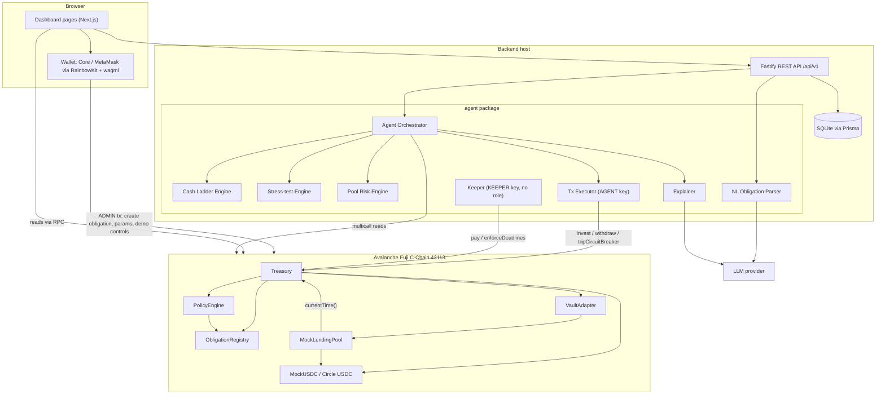

# RunwayMind — AI CFO for DAOs

*The Treasury That Never Runs Out of Cash. The AI That Never Exceeds Its Authority.*

RunwayMind manages a DAO's stablecoin treasury around its **future obligations** — payroll, grants, invoices. It invests
only capital that is genuinely idle within a safety horizon, pulls funds back before every payment deadline, and pays
obligations on-chain on the due date. An AI agent recommends and executes treasury moves, but every limit it works
within — reserve ratio, deadlines, exposure, whitelist, no outbound transfers, circuit breaker — is enforced by smart
contracts on Avalanche, so even a hacked agent cannot move funds out. Built for Team1 Vietnam UniHack 2026 (Avalanche,
track: AI Agents & Security). Full engineering specification: `docs/` (kept private by the team).

| | |
|---|---|
| Demo video | _link to be added_ |
| Slides | _link to be added_ |
| Network | Avalanche Fuji C-Chain (chain ID 43113) |

## Problem

DAOs keep most of their treasury in stablecoins and have fixed recurring costs. Today they choose between two bad
options: **keep funds idle** (safe, earns nothing, runway shrinks) or **deposit into DeFi lending pools** (earns yield,
but a pool can be paused, exploited or 100 % utilized exactly when payroll is due — Euler Finance and SVB, March 2023).
Existing yield bots optimize *balance × APY* and do not know that payroll is due next week.

## Solution — three pillars

| Pillar | What it does | Enforced by |
|---|---|---|
| **Obligation-aware Cash Ladder** | Projects future outflows; only capital not needed within the safety horizon *H* (14 days) is invested; funds return before each obligation's withdrawal deadline | Off-chain engine computes, on-chain `PolicyEngine` enforces (R1, R2) |
| **Bounded AI agent** | Recommends (Approve mode) or executes (Auto mode) invest / withdraw / circuit-breaker actions, with LLM explanations grounded in engine facts, Pool Risk Score, stress tests and natural-language obligation entry. The LLM never produces numbers used in transactions | On-chain `Treasury` + `PolicyEngine` (R1–R6) |
| **Automated on-chain payments** | Obligations are paid on the due date to the registered recipient through `pay()`; keeper functions are public, so payroll does not depend on the team's server | `Treasury.pay()`, `Treasury.enforceDeadlines()` |

This is banking Asset-Liability Management (match asset maturity to liability maturity) applied to DeFi.

## Architecture



Monorepo (pnpm workspaces): `contracts/` (Solidity 0.8.24, Foundry, OpenZeppelin 5.1), `packages/shared` (types, zod
schemas, ABIs, deployments), `agent/` (pure engines, orchestrator, executor, keeper, LLM), `backend/` (Fastify 4,
Prisma 5), `frontend/` (Next.js 14, wagmi 2, RainbowKit 2, TanStack Query 5, Recharts). Layout: docs/14 (private spec).

## Security model

The AGENT key can only move funds **between the Treasury and whitelisted adapters** and trip the circuit breaker.
There is no transfer, sweep, approve, `receive` or `fallback` on the Treasury; the only outbound token transfer is
`pay(obligationId)` to a recipient that only ADMIN can register.

| Rule | Guarantee | Enforced in |
|---|---|---|
| R1 Reserve Ratio | Idle balance after an investment ≥ obligations due within *H* + emergency buffer | `PolicyEngine.checkInvest` |
| R2 Withdrawal Deadline | Funds for an obligation are back in the Treasury *H* before its due date; anyone can call `enforceDeadlines()` | `PolicyEngine.liquidityShortfall`, `Treasury.enforceDeadlines` |
| R3 Exposure Limit | Balance in one adapter ≤ `maxExposureBps` × total assets | `PolicyEngine.checkInvest` |
| R4 Whitelist | Only `ACTIVE` adapters receive funds (`WITHDRAW_ONLY` can only be drained) | `PolicyEngine.checkInvest`, `adapterStatus` |
| R5 No External Transfer | Structural: no function can send Treasury funds anywhere except `pay()` | `Treasury` (absence of functions) |
| R6 Circuit Breaker | AGENT or ADMIN can stop all new investment; only ADMIN can reset; withdrawals and payments keep working | `Treasury.invest` guard |

Hacked-agent demo: `pnpm demo:attack` sends five attacks with the AGENT key (transferFrom, direct adapter withdraw, raw
`transfer` selector, fake obligation, invest beyond reserve). All five revert on-chain, the last with
`ReserveViolation`. Rehearsal evidence (tx hashes): [docs/CP2_REPORT.md](docs/CP2_REPORT.md).

## Deployed contracts — Avalanche Fuji (43113)

All contracts are verified on Snowtrace. Machine-readable copies: [deployment/fuji.json](deployment/fuji.json),
[deployment/fuji-usdc.json](deployment/fuji-usdc.json).

**Demo treasury (MockUSDC, demo mode)** — deploy block `60935515` (CP2 Run 2, [docs/CP2_REPORT.md](docs/CP2_REPORT.md))

| Contract | Address |
|---|---|
| Treasury | [`0xea19CD2eE794e29c977f85d867BF730Cf65eab92`](https://testnet.snowtrace.io/address/0xea19CD2eE794e29c977f85d867BF730Cf65eab92) |
| ObligationRegistry | [`0x4B0e94ECCf64175385374F091c1A424c9543FA36`](https://testnet.snowtrace.io/address/0x4B0e94ECCf64175385374F091c1A424c9543FA36) |
| PolicyEngine | [`0xa862F86092Aa6625A771f964cDAaa50a36BbFA53`](https://testnet.snowtrace.io/address/0xa862F86092Aa6625A771f964cDAaa50a36BbFA53) |
| VaultAdapter | [`0x31762954AdDD4FbAB318B9Ac375083434BA01d66`](https://testnet.snowtrace.io/address/0x31762954AdDD4FbAB318B9Ac375083434BA01d66) |
| MockLendingPool | [`0x7300607b351A7D0295b81A798264b35B54d91fDa`](https://testnet.snowtrace.io/address/0x7300607b351A7D0295b81A798264b35B54d91fDa) |
| MockUSDC (6 decimals) | [`0x561c9B3C8532C577a4b65D0b1E881FB485e58B50`](https://testnet.snowtrace.io/address/0x561c9B3C8532C577a4b65D0b1E881FB485e58B50) |

**Real-USDC treasury (Circle USDC `0x5425890298aed601595a70AB815c96711a31Bc65`)** — deploy block `60926117`,
smoke test: [docs/USDC_SMOKE_TEST.md](docs/USDC_SMOKE_TEST.md)

| Contract | Address |
|---|---|
| Treasury | [`0x9266315F3A56f58c388a7806A845e2E142Db1281`](https://testnet.snowtrace.io/address/0x9266315F3A56f58c388a7806A845e2E142Db1281) |
| ObligationRegistry | [`0xCF51e2a0D381D6784f49Ce6eA464F304D2887b29`](https://testnet.snowtrace.io/address/0xCF51e2a0D381D6784f49Ce6eA464F304D2887b29) |
| PolicyEngine | [`0x74507fDa9103A17ECEDeA9aD125f221a1Ebb0941`](https://testnet.snowtrace.io/address/0x74507fDa9103A17ECEDeA9aD125f221a1Ebb0941) |
| VaultAdapter | [`0x64f4B89e58a4a66cCd76BfF053932Ee293599528`](https://testnet.snowtrace.io/address/0x64f4B89e58a4a66cCd76BfF053932Ee293599528) |
| MockLendingPool (USDC) | [`0x38a37946ed9B9efD9396EfdD21b8d682E7652090`](https://testnet.snowtrace.io/address/0x38a37946ed9B9efD9396EfdD21b8d682E7652090) |

| Role | Address |
|---|---|
| ADMIN (deployer) | `0xaC9309a1C6C150D98111AfffF851D07AD650CB5E` |
| AGENT | `0x901999461cB4ecF9d971458A6aaf4bFbEbbB0051` |
| KEEPER (no role) | `0xe052cDe7C1c7060fCE44e862FD6E60307c3649B1` |

The `AaveV3Adapter` proves the same Treasury works with a real protocol on an Avalanche **mainnet fork**
(`forge test --match-path "test/fork/*" --fork-url $env:AVALANCHE_MAINNET_RPC_URL`).

## Run locally (Windows PowerShell)

Requirements: Node ≥ 22.13 (pnpm 11), pnpm, Foundry (`forge`, `anvil`, `cast`).

```powershell
pnpm install
Copy-Item .env.example .env           # fill in keys/RPC (docs/11 §4); never commit .env
pnpm build                            # forge build + all workspace packages
pnpm test                             # forge test + all workspace tests
```

Local chain (Anvil):

```powershell
anvil --chain-id 31337                                                            # terminal 1
forge script scripts/Deploy.s.sol --rpc-url http://127.0.0.1:8545 --broadcast    # terminal 2 (Anvil key 0)
forge script scripts/SeedDemo.s.sol --rpc-url http://127.0.0.1:8545 --broadcast
pnpm sync-abi
pnpm --filter @runwaymind/backend db:deploy
pnpm --filter @runwaymind/backend db:seed
pnpm dev                                                                          # API :4000, UI http://localhost:3000
```

Fuji: set the keys and RPC in `.env` (docs/11 §4), deploy with docs/11 §7, then `pnpm dev`. Useful scripts:
`pnpm demo:attack` (hacked-agent scene), `pnpm demo:usdc-smoke` (real-USDC smoke run), `pnpm demo:reset` (fresh demo
deployment). Free-tier RPCs limit `eth_getLogs`; set `INDEXER_BLOCK_RANGE` in `.env` (e.g. 5–10) when using one.

## Team

_Names and roles to be added_ (A: smart contracts · B: agent + backend · C: frontend, integration, pitch).

## License

_To be decided by the team — add a `LICENSE` file before submission._
